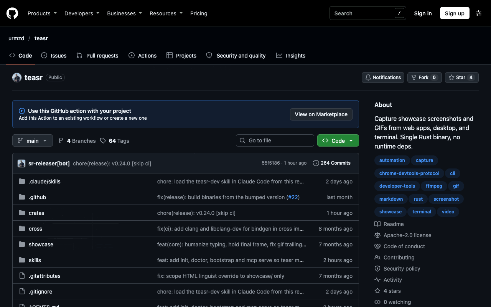
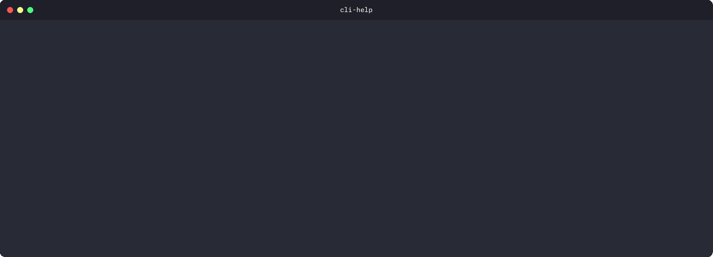

<p align="center">
  <h1 align="center">teasr</h1>
  <p align="center">
    Automated project showcase capture: screenshots and GIFs from web apps, desktop, and terminal. Single binary, no runtime dependencies.
    <br /><br />
    <a href="https://github.com/urmzd/teasr/releases">Download</a>
    &middot;
    <a href="https://github.com/urmzd/teasr/issues">Report Bug</a>
    &middot;
    <a href="https://github.com/urmzd/teasr/blob/main/action.yml">CI Integration</a>
  </p>
</p>

<p align="center">
  <a href="https://github.com/urmzd/teasr/actions/workflows/ci.yml"></a>
  <a href="https://crates.io/crates/teasr"></a>
  &nbsp;
  <a href="LICENSE"></a>
</p>

## Showcase

<table align="center">
  <tr>
    <td align="center"><strong>Web Capture</strong></td>
    <td align="center"><strong>Terminal Capture</strong></td>
  </tr>
  <tr>
    <td align="center"></td>
    <td align="center"></td>
  </tr>
  <tr>
    <td align="center"><strong>Local HTML</strong></td>
    <td align="center"><strong>Markdown</strong></td>
  </tr>
  <tr>
    <td align="center"></td>
    <td align="center"></td>
  </tr>
</table>

## Contents

- [Why teasr](#why-teasr)
- [Installation](#installation)
- [Quick Start](#quick-start)
- [Capture Modes](#capture-modes)
- [Configuration Reference](#configuration-reference)
- [CLI Reference](#cli-reference)
- [Output Formats](#output-formats)
- [MCP Server](#mcp-server)
- [CI Integration](#ci-integration)
- [Workspace](#workspace)
- [Agent Skill](#agent-skill)
- [License](#license)

## Why teasr

| | teasr | Node/Playwright approach |
|---|---|---|
| Runtime | Single binary | Node.js + npm install |
| Terminal render | Built-in (ANSI → SVG → PNG) | External tools |
| GIF encoding | gifski (pure Rust) | FFmpeg or ImageMagick |
| Config | `teasr.toml` | JS/TS config file |
| Server cleanup | Process group kill | Manual or best-effort |

## Installation

**Shell installer (recommended):**

```bash
curl -fsSL https://raw.githubusercontent.com/urmzd/teasr/main/install.sh | sh
```

**Cargo:**

```bash
cargo install teasr-cli
```

**GitHub Action:** see [CI Integration](#ci-integration) below.

## Quick Start

Write a starter config and run it:

```bash
teasr init          # writes teasr.toml (a terminal recording; needs no browser)
teasr run           # writes ./showcase/demo.gif and demo.png
```

`teasr init --list` shows the other templates: `teasr init web`, `teasr init markdown`. `teasr doctor` checks that Chrome is installed for web scenes.

Or create `teasr.toml` in your project root by hand:

```toml
[server]
command = "npm run dev"
url = "http://localhost:3000"
timeout = 10000

[output]
dir = "./showcase"
formats = [{ output_type = "png" }]

[[scenes]]
type = "web"
uri = "/"
name = "homepage"
formats = [{ output_type = "gif" }, { output_type = "png" }]

[[scenes.interactions]]
type = "snapshot"

[[scenes.interactions]]
type = "click"
selector = "#get-started"

[[scenes.interactions]]
type = "snapshot"

[[scenes]]
type = "terminal"
name = "cli-help"
theme = "dracula"
cols = 90
rows = 24
formats = [{ output_type = "gif" }, { output_type = "png" }]

[[scenes.interactions]]
type = "type"
text = "teasr --help"
speed = 50

[[scenes.interactions]]
type = "key"
key = "enter"

[[scenes.interactions]]
type = "wait"
duration = 2000
```

Then run:

```bash
teasr run
```

Output files are written to `./showcase/`.

## Capture Modes

All three capture modes (`terminal`, `web`, `screen`) use a unified `[[scenes.interactions]]` syntax. Every interaction type is accepted by every mode; unsupported interactions are silently skipped (visible with `--verbose`). The `web` scene loads remote URLs, local files (HTML/SVG/PDF), or Markdown files through the same headless-Chrome renderer.

### Interaction Types

| Type | Fields | Description |
|------|--------|-------------|
| `type` | `text`, `speed` (ms per char, optional) | Type text (terminal: PTY input, web: keyboard events) |
| `key` | `key` (e.g. `"enter"`) | Press a key |
| `click` | `selector` (CSS selector, optional) | Click an element |
| `hover` | `selector` (CSS selector, optional) | Hover over an element |
| `scroll-to` | `selector` (CSS selector, optional) | Scroll an element into view |
| `wait` | `duration` (ms, default 1000) | Pause. Terminal/screen emit one frame at the end of the pause (`duration_ms = duration`); web emits nothing; follow with `snapshot` to capture post-pause state. |
| `snapshot` | `name` (optional) | Capture the current state as a frame |

Every interaction also accepts a `hidden` flag (default `false`). Hidden interactions execute normally but their frames are excluded from output. This is useful for setup steps (e.g. typing a command) that should not appear in the final GIF or screenshot.

```toml
[[scenes.interactions]]
type = "type"
text = "cd my-project"
hidden = true

[[scenes.interactions]]
type = "key"
key = "enter"
hidden = true

[[scenes.interactions]]
type = "wait"
duration = 500
hidden = true
```

### Web

Loads a URI in headless Chrome (via chromiumoxide). The `uri` field picks what to load:

- `http://` / `https://`: remote URL (a leading `/` joins against `[server].url` if configured)
- `*.md` / `*.markdown`: Markdown file rendered to styled HTML
- anything else: local file (HTML, SVG, PDF) loaded via `file://`

Requires Chrome or Chromium to be installed.

```toml
# Remote URL (or server-relative path with [server])
[[scenes]]
type = "web"
uri = "/dashboard"
name = "dashboard"
viewport = { width = 1440, height = 900 }
formats = [{ output_type = "png" }, { output_type = "gif" }]

[[scenes.interactions]]
type = "click"
selector = "#open-modal"

[[scenes.interactions]]
type = "snapshot"
name = "modal-open"

# Local HTML / SVG
[[scenes]]
type = "web"
uri = "./docs/preview.html"
name = "docs-preview"

[[scenes.interactions]]
type = "snapshot"

# PDF (page selection via the `page` field)
[[scenes]]
type = "web"
uri = "./spec.pdf"
page = 2

[[scenes.interactions]]
type = "snapshot"

# Markdown (rendered with the bundled GitHub-style template)
[[scenes]]
type = "web"
uri = "./README.md"
theme = "dark"           # "light" (default) or "dark"
flavor = "github"        # "github" (default), "commonmark", or "custom"
full_page = true

[[scenes.interactions]]
type = "snapshot"
```

**Web scene fields:**

| Field | Type | Default | Description |
|-------|------|---------|-------------|
| `uri` | string | required | Remote URL, server-relative path, local file, or Markdown file |
| `name` | string | uri value | Output filename base |
| `viewport` | object | `1280x720` | `{ width, height }` |
| `formats` | array | `output.formats` | Per-scene format override |
| `interactions` | array | `[]` | Sequence of interactions |
| `full_page` | boolean | `false` | Capture full page height instead of just the viewport |
| `color_scheme` | string | top-level `color_scheme` | Emulated `prefers-color-scheme`: `"light"` or `"dark"`. Unset, the page follows the machine that runs the capture |
| `frame_duration` | integer | `100` | Milliseconds per frame in GIF output |
| `page` | integer | `1` | PDF page to capture (only applies when `uri` is a PDF) |
| `theme` | string | `"light"` | Markdown theme: `"light"` or `"dark"` (Markdown only) |
| `redact` | table | none | PII redaction overrides for this scene (see [`[redact]`](#redact)) |
| `flavor` | string | `"github"` | Markdown flavor: `"github"`, `"commonmark"`, `"custom"` (Markdown only) |
| `stylesheet` | string | none | Path to a custom CSS file appended after the default styles (Markdown only) |
| `template` | string | none | Path to a full HTML template with `{{content}}` placeholder; overrides the default template (Markdown only) |

**Markdown flavor details:**

| Flavor | Behavior |
|--------|----------|
| `github` | GitHub Flavored Markdown: tables, task lists, autolinks, strikethrough, footnotes |
| `commonmark` | Strict CommonMark, no extensions |
| `custom` | GFM extensions enabled; pair with `stylesheet` to apply your own visual style |

**Supported interactions:** `click`, `hover`, `scroll-to`, `wait`, `snapshot`, `type`, `key`

### Terminal

Scripts an interactive PTY session, captures frames at each interaction, and renders them as animated GIFs or PNGs with terminal chrome (title bar, traffic light buttons).

```toml
[[scenes]]
type = "terminal"
name = "test-output"
theme = "dracula"
cols = 100
rows = 24
formats = [{ output_type = "gif" }, { output_type = "png" }]
frame_duration = 80

[[scenes.interactions]]
type = "type"
text = "cargo test 2>&1"
speed = 50

[[scenes.interactions]]
type = "key"
key = "enter"

[[scenes.interactions]]
type = "wait"
duration = 2000
```

**Terminal scene fields:**

| Field | Type | Default | Description |
|-------|------|---------|-------------|
| `name` | string | `"recording"` | Output filename base |
| `theme` | string | `"dracula"` | `"dracula"` or `"monokai"` |
| `cols` | integer | `80` | Terminal width in columns |
| `rows` | integer | `24` | Terminal height in rows |
| `interactions` | array | `[]` | Sequence of interactions |
| `frame_duration` | integer | `100` | Milliseconds per frame in GIF output |
| `formats` | array | `output.formats` | Per-scene format override |
| `redact` | table | none | PII redaction overrides for this scene (see [`[redact]`](#redact)) |

**Supported interactions:** `type`, `key`, `wait`, `snapshot`

### Screen

Captures a display, window, or region using native screen capture (xcap). Screenshots are automatically wrapped in macOS-style window chrome (matching terminal output). Supports multi-frame GIF output when multiple `snapshot` + `wait` interactions are configured.

> [!WARNING]
> Screen captures record whatever is visible on your display: notifications, browser tabs, menu bar items, and other windows may contain personal information (emails, names, tokens, messages). Always review the output before publishing it. Prefer capturing a specific `window` or `region` over a full display to limit exposure, and use [`[redact]`](#redact) to hide known-sensitive areas.

```toml
[[scenes]]
type = "screen"
name = "native-app"
setup = "open MyApp.app"
delay = 2000
theme = "dracula"
title = "My App"
formats = [{ output_type = "gif" }, { output_type = "png" }]

[[scenes.interactions]]
type = "snapshot"

[[scenes.interactions]]
type = "wait"
duration = 1000

[[scenes.interactions]]
type = "snapshot"
```

**Screen scene fields:**

| Field | Type | Default | Description |
|-------|------|---------|-------------|
| `name` | string | `"screen"` | Output filename base |
| `display` | integer | primary | Display index (ignored if `window` is set) |
| `window` | string | none | Window title or app name substring (case-insensitive) |
| `region` | object | full display | `{ x, y, width, height }` |
| `setup` | string | none | Shell command run before capture |
| `delay` | integer | none | Milliseconds to wait after setup |
| `interactions` | array | `[]` | Sequence of interactions |
| `frame_duration` | integer | `100` | Milliseconds per frame in GIF output |
| `title` | string | `"Screen Capture"` | Title shown in chrome frame title bar |
| `theme` | string | `"dracula"` | Chrome frame theme: `"dracula"` or `"monokai"` |
| `formats` | array | `output.formats` | Per-scene format override |
| `redact` | table | none | PII redaction overrides for this scene (see [`[redact]`](#redact)) |

**Supported interactions:** `snapshot`, `wait`

## Configuration Reference

### `[server]`

Optional. Starts a process before capture and health-polls it until ready. The process group is killed on exit, so no orphaned processes remain.

```toml
[server]
command = "npm run dev"
url = "http://localhost:3000"
timeout = 10000          # ms to wait for server to be ready (default: 10000)
```

### `[redact]`

Optional. Hides PII and secrets in captured output. Configure globally with `[redact]` (applies to every scene) and/or per scene with `[scenes.redact]`. Scene lists extend the global lists, scene scalars override global ones.

```toml
[redact]
patterns = ["email", "secrets"]   # built-in pattern names (see table below)
custom = ['acme-[0-9a-f]{16}']    # extra regexes (single-quote to avoid TOML escapes)
literals = ["internal-host"]      # exact strings to mask
username = true                   # mask $USER, the hostname, and home-directory paths
mask = "•"                        # replacement character (default: "•")
style = "block"                   # default region/selector style: "block", "blur", "pixelate"

[[scenes]]
type = "web"
uri = "/dashboard"

[scenes.redact]
selectors = [".user-email", "#avatar"]   # CSS selectors masked with page overlays (web only)

[[scenes.redact.regions]]                # pixel rectangles hidden in every frame (any scene type)
x = 840
y = 12
width = 220
height = 32
style = "pixelate"                       # optional per-region override
```

How each mechanism applies:

| Mechanism | Scene types | How it works |
|---|---|---|
| `patterns` / `custom` / `literals` / `username` | terminal | Matched text is replaced character-for-character with `mask` on the terminal grid *before* rendering; layout and colors are untouched, and tokens that wrap across lines are still caught. |
| `selectors` | web | Each matching element is covered with an overlay before every screenshot (solid fill, or backdrop blur when `style = "blur"`; `pixelate` falls back to solid). Works with `full_page` and GIFs. |
| `regions` | all | The rectangle is blocked, blurred, or pixelated in every captured frame. For screen scenes this happens on the raw capture (before window chrome), with coordinates relative to the captured/cropped area. |

**Built-in patterns:** `email`, `ipv4`, `ipv6`, `ssn`, `credit-card`, `phone`, `home-path`, and the token patterns `aws-key`, `github-token`, `slack-token`, `google-api-key`, `stripe-key`, `openai-key`, `anthropic-key`, `npm-token`, `jwt`, `private-key`, `bearer-token`. The name `secrets` expands to all of the token patterns at once.

**Limitations (still review before publishing):**

- Pattern matching needs the whole token visible. A secret *typed on camera* leaks in intermediate frames (each keystroke shows a partial token no pattern can match) and its shell echo can scroll apart. Type secrets in `hidden = true` steps instead, and let redaction handle program *output*.
- Terminal patterns see text; web and screen frames are pixels, so those modes rely on `selectors` and `regions`. They hide what you tell them to, not what they detect.
- `blur` leaves recognizable shapes; prefer `block` (the default) for anything genuinely secret.

### `[output]`

```toml
[output]
dir = "./showcase"       # default: "./teasr-output"
formats = [{ output_type = "png" }]  # default: [{ output_type = "png" }]. Options: "png", "gif", "mp4"
```

### Top-level keys

```toml
fps = 24                 # default: 24. Frames per second (sets default frame_duration = 1000/fps).
seconds = 2.5            # default: 2.5. Target output duration in seconds.
scene_timeout = 60       # default: 60. Per-scene wall-clock timeout in seconds.
outro_hold_ms = 1500     # default: 1500. Minimum hold time for the final frame of every scene
                         # before the GIF loops, so viewers can read the result. Set to 0 to disable.
color_scheme = "dark"    # default: unset. Emulated prefers-color-scheme for web scenes:
                         # "light" or "dark". A scene's own color_scheme wins.
```

Without `color_scheme`, headless Chrome reports the color scheme of the machine it runs on, so the same config can produce light captures in CI and dark ones on a laptop. Set it to make captures the same everywhere. To capture both schemes from one config, run it twice: `teasr run --color-scheme light -o showcase/light` and `teasr run --color-scheme dark -o showcase/dark`.

The default `type` interaction speed is `80 ms` per character with ±20 % jitter, which reads as fast human typing rather than a uniform stream. Override per interaction with `speed = <ms>` for a fixed cadence.

### `[[scenes]]`

Each `[[scenes]]` entry is one of the three types described above. The `type` field is required and must be `"web"`, `"terminal"`, or `"screen"`.

Config file discovery walks up from the current directory to the filesystem root, so running `teasr` from any subdirectory of your project will find `teasr.toml` at the root.

## CLI Reference

```
teasr [COMMAND]

Commands:
  init         Write a starter teasr.toml in the current directory
  run          Run capture scenes from teasr.toml (alias: `showme`)
  fonts        List the fonts teasr can install, or install one by name
  doctor       Check that teasr can work on this machine
  bootstrap    Install the bundled agent skill and register the MCP server
  mcp          Serve teasr to agents over MCP
  completions  Print shell completions on stdout
  update       Self-update teasr to the latest release
  version      Print the current version
  help         Print this message or the help of the given subcommand(s)

Options:
      --format <FORMAT>  Result output: human (on stderr) or json (one document on stdout) [default: human]
  -h, --help             Print help
  -V, --version          Print version
```

### `teasr run`

```
teasr run [OPTIONS]

Options:
  -c, --config <PATH>          Path to teasr.toml (default: auto-discover)
  -o, --output <DIR>           Output directory (overrides config)
      --formats <FMT,...>      Output formats: png, gif, mp4 (overrides config)
      --verbose                Enable debug logging
      --timeout <MS>           Global timeout in ms [default: 60000]
      --fps <N>                Frames per second (overrides config)
      --seconds <N>            Target output duration in seconds (overrides config)
      --scene-timeout <N>      Per-scene wall-clock timeout in seconds (overrides config)
      --color-scheme <SCHEME>  Emulated prefers-color-scheme for web scenes: light or dark (overrides config)
      --scene <NAME>           Only run scenes matching these names or types [aliases: --scenes]
      --format <FORMAT>        Result output: human (on stderr) or json (one document on stdout) [default: human]
  -h, --help                   Print help
```

`--formats` accepts comma-separated values: `--formats png,gif,mp4`

`--scene` selects scenes by `name` (or by type: `terminal`, `web`, `screen`). Repeat it or pass a comma-separated list: `--scene cli-help --scene demo` is the same as `--scenes cli-help,demo`. A name that matches no scene is an error, so a typo never silently runs a different set. Use it to re-capture one scene without executing the others, which matters when a terminal scene types real commands into a live shell.

### JSON report

`--format json` prints one JSON document on stdout when the run ends. Progress and logs stay on stderr. Use it when a script or an agent needs the output paths, or needs to know which scenes failed.

```bash
teasr run --format json
```

```json
{
  "output_dir": "/work/showcase",
  "captured": 1,
  "failed": 1,
  "scenes": [
    {
      "name": "homepage",
      "type": "web",
      "status": "ok",
      "files": ["/work/showcase/homepage.png"],
      "duration_ms": 1211
    },
    {
      "name": "docs-preview",
      "type": "web",
      "status": "failed",
      "files": [],
      "error": "file not found: ./docs/preview.html: No such file or directory (os error 2)",
      "duration_ms": 0
    }
  ]
}
```

Paths are absolute. `error` is present only on a failed scene. The exit code is `0` when at least one scene was captured and `1` when every scene failed, so read `failed` to detect a partial run. An error that stops the run before any scene starts (a bad config, a server that does not come up) prints no report.

`--format` is not `--formats`: `--formats` picks the capture file types.

### Other commands

| Command | Does |
|---------|------|
| `teasr init [TEMPLATE]` | Writes `teasr.toml`. Templates: `terminal` (default), `web`, `markdown`. `--list` shows them. It keeps an existing file unless `--force` is set |
| `teasr doctor` | Checks Chrome, the font the config asks for, the config file, the installed agent skill and the MCP registration. Prints the fix for each failed check. Exits 1 when Chrome is missing |
| `teasr fonts [NAME]` | Lists the fonts teasr can install, or installs one |
| `teasr bootstrap` | Installs the agent skill and registers the MCP server. See [Agent Skill](#agent-skill) |
| `teasr completions <SHELL>` | Prints completions for `bash`, `zsh`, `fish`, `elvish` or `powershell` |
| `teasr update` | Replaces the binary with the latest release |
| `teasr version` | Prints `teasr v<version>` |

Every command accepts `--format json` and then prints one JSON document on stdout. `teasr setup` is the old name of `fonts` and `doctor`; it still works in this release.

## Output Formats

| Format | Notes |
|--------|-------|
| `png` | Lossless screenshot. Native, no external tools required. |
| `gif` | Animated GIF from multi-frame session recording, encoded with gifski (pure Rust). |
| `mp4` | Video output from multi-frame session recording. |

## MCP Server

`teasr mcp serve` serves one tool, `capture`, over the Model Context Protocol on stdio. An agent sends scenes and gets back the files written, so it can produce a screenshot or a GIF without a `teasr.toml`.

```bash
teasr mcp serve --root ./site --output ./captures
```

```
teasr mcp serve [OPTIONS]

Options:
      --allow <ALLOW>      Scene types a caller may run (comma-separated: web,terminal,screen) [default: web]
      --root <ROOT>        Local files a web scene loads must be inside this directory [default: .]
  -o, --output <OUTPUT>    Each call writes to a new directory under this one [default: ./teasr-output]
      --timeout <TIMEOUT>  Time limit for one capture call in milliseconds [default: 60000]
      --verbose            Enable verbose logging (on stderr)
```

`teasr bootstrap` registers the server in every AI tool that agentspec manages. To register it by hand, add a stdio server to the client's config:

```json
{
  "mcpServers": {
    "teasr": { "command": "teasr", "args": ["mcp", "serve", "--root", "./site"] }
  }
}
```

`teasr mcp tools` prints the tool list and its input schema as JSON without starting a server. Use it to read the schema, or to pin it: the schema changes when `--allow` changes.

### The `capture` tool

Scenes have the same fields as `[[scenes]]` in `teasr.toml`, written as JSON. Two things differ: every scene needs a `name`, and `formats` is a list of names.

```json
{
  "color_scheme": "dark",
  "scenes": [
    {
      "type": "web",
      "name": "pricing",
      "uri": "https://example.com/pricing",
      "viewport": { "width": 1280, "height": 720 },
      "formats": ["png", "gif"],
      "interactions": [
        { "type": "snapshot" },
        { "type": "click", "selector": "#annual" },
        { "type": "snapshot" }
      ]
    }
  ]
}
```

| Argument | Type | Default | Description |
|----------|------|---------|-------------|
| `scenes` | array | required | Scenes to capture, in order |
| `formats` | array | `["png"]` | `"png"`, `"gif"`. A scene's own `formats` wins |
| `color_scheme` | string | unset | `"light"` or `"dark"`. A scene's own `color_scheme` wins |
| `viewport` | object | `1280x720` | `{ width, height }` for web scenes |
| `inline_images` | boolean | `true` | Also return PNG outputs as images: at most 6, each at most 2 MiB |

The result is the same report as [`teasr run --format json`](#json-report), as text and as `structuredContent`, followed by the inline images. A scene that fails while it runs is reported in `scenes` and does not stop the others. `isError` is `true` when every scene failed or the arguments were refused.

### What a caller can do

The limits are set when the server starts. A caller cannot change them.

| Limit | Flag | Default |
|-------|------|---------|
| Scene types | `--allow` | `web` only |
| Local files a web scene can load | `--root` | the working directory |
| Where files are written | `--output` | `./teasr-output`, one new directory per call |

- `--allow terminal` lets a caller run shell commands. `--allow screen` lets a caller record the display. Allow them only for a caller you trust.
- A path that leaves `--root`, directly or through a symlink, is refused. Scene names cannot contain a path separator, so a caller cannot write outside its call directory.
- `[server]` and `[redact]` are not available through the tool.
- These checks are not a sandbox. A web scene can load any `http(s)` URL the machine can reach, and a local HTML page can reference other local files. Run the server inside a sandbox when the caller is not trusted.

## CI Integration

The GitHub Action downloads the appropriate pre-built binary from releases, installs Chrome, and runs `teasr run`. All configuration comes from `teasr.toml`.

```yaml
- uses: urmzd/teasr@v1
  with:
    version: "latest"        # optional, pin to e.g. "0.11.0"
    scenes: "web,terminal"   # optional, default: all
    install-chrome: "true"   # optional, set "false" if Chrome is already available
    install-fonts: ""        # optional, space-separated font families
    config: ""               # optional, path to teasr.toml
    args: ""                 # optional, extra flags for `teasr run`
```

**Supported runners:** `ubuntu-*`, `macos-*`, `windows-*` on x64 and ARM64.

## Workspace

teasr is a Cargo workspace with two crates:

| Crate | Description |
|-------|-------------|
| [`teasr-cli`](crates/teasr-cli) | CLI entry point (`teasr` binary) |
| [`teasr-core`](crates/teasr-core) | Capture, config, orchestration, and ANSI → SVG → PNG terminal rendering |

## Agent Skill

The usage skill ships inside the binary, so it always matches the version you run. Install it for your AI tools with one command:

```bash
teasr bootstrap
```

It does three things through [agentspec](https://github.com/urmzd/agentspec):

1. Writes the skill to `~/.local/share/teasr/skills/teasr/SKILL.md`.
2. Installs it into every AI tool agentspec manages. Then `/teasr` works in each one.
3. Registers the [MCP server](#mcp-server) `teasr mcp serve`.

- Run it again after `teasr update` to refresh the skill.
- A different skill that is already named `teasr` is kept. `--force` replaces it.
- `--dry-run` shows the commands and changes nothing.
- Without agentspec, it writes the skill file and prints the MCP config to add by hand.

The skill source is [`crates/teasr-cli/skills/teasr/`](crates/teasr-cli/skills/teasr/); `skills/teasr` links to it. [`skills/teasr-dev/`](skills/teasr-dev/) is for people who change teasr itself.

## License

Apache-2.0
